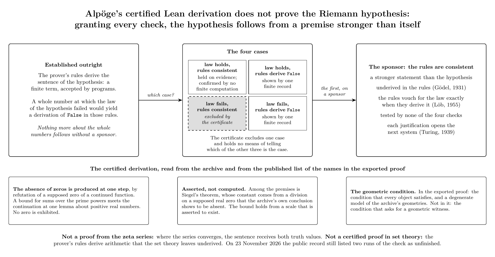

# Alpöge's Certified Lean Derivation Does Not Prove the Riemann Hypothesis

**Granting Every Check, the Hypothesis Follows from a Premise Stronger Than Itself**

Parker Emmerson (Yaohushuason)<br>
Independent Researcher<br>
ORCID [0009-0007-1288-3292](https://orcid.org/0009-0007-1288-3292)<br>
Parkeremmerson@icloud.com

Version 5, 23 November 2026

**[Read the note (PDF, 48 pages)](Alpoge_Certified_Lean_Derivation_Does_Not_Prove_the_Riemann_Hypothesis_v5.pdf)**



## The statement of the note

On 20 November 2026 Levent Alpöge released a note stating his belief that he has proved the Riemann hypothesis, with an archive for the Lean theorem prover in which the argument is formalized "without assumptions." On 21 November the Lean and Mathlib communities certified the statement and the derivation.

The certified derivation does not prove the Riemann hypothesis. The note grants every check of the certification: a finite term in the rules of the Lean prover whose type is the sentence of the hypothesis exists and is accepted by programs. A derivation in those rules is not a proof of the hypothesis, in three senses.

1. **It does not establish that the hypothesis holds of the whole numbers.** What the certified derivation establishes outright, about the whole numbers, is one conditional: a whole number at which the law of the hypothesis failed would yield a derivation of `False` in the prover's rules. The law itself follows from one premise, its sponsor: the consistency of the rules. That sponsor is a stronger statement than the hypothesis. The rules leave it underived if it holds. They derive that they are right about this law exactly when they derive the law (Löb, 1955). Every derivation of it elsewhere rests on a further sponsor of the same kind, along the progression of stronger systems that Turing described in 1939. None of the four checks of the certification tests it.
2. **It is not a proof from the zeta series.** On the half-plane where the series converges, the sentence of the hypothesis receives both truth values, one at some completions of the series and the other at others. The derivation takes the analytic continuation, the excluded middle and clauses that write "0" from the rules.
3. **It is not a certified proof in the set theory to which the word "proved" ordinarily refers.** The prover's rules derive a statement of arithmetic that this set theory leaves underived, so a derivation in the rules is not thereby a derivation in it.

The first of the three holds of every law of the whole numbers that the rules derive, and the note says so. The second and the third are particular to the hypothesis and to the prover.

## What the note reads in the certified archive

The note reads the certified derivation against the published list of the 1,484,733 declarations, constructors and recursors of the exported proof.

- The absence of zeros is produced at one step, by the refutation of a supposed zero of a continued function. A bound for sums over the prime powers meets the continuation at one lemma about positive real numbers. The derivation exhibits no zero.
- Among the premises is the theorem of Siegel (1935). Its constant is asserted through a division on a supposed real zero that the archive's own conclusion shows to be absent.
- The condition that the archive names for geometry is filled by the one that holds of every object. The condition that asks for a geometric witness is absent from the exported proof.
- On 23 November 2026 the public verification record still listed two runs of the check as unfinished.

## Files

- **[The note](Alpoge_Certified_Lean_Derivation_Does_Not_Prove_the_Riemann_Hypothesis_v5.pdf)** (PDF, 48 pages).
- **[The LaTeX source of the note](Alpoge_Certified_Lean_Derivation_Does_Not_Prove_the_Riemann_Hypothesis_v5.tex).** It compiles on its own with `pdflatex`.
- **[The executed notebook](Alpoge_Certified_Lean_Derivation_Does_Not_Prove_the_Riemann_Hypothesis_v5_SI.ipynb).** It reproduces every reading and every number that the note reports.
- **[The Lean file](Alpoge_Certified_Lean_Derivation_Does_Not_Prove_the_Riemann_Hypothesis_v5_Lean/CompletenessOfValues.lean)**, in [a folder](Alpoge_Certified_Lean_Derivation_Does_Not_Prove_the_Riemann_Hypothesis_v5_Lean) with its build files and the log of a successful build. It holds the statements of the note that concern the prover's own rules, checked in Lean 4.33.1, the version to which the certified archive is pinned. The file is self-contained: it uses the prover's prelude and no library.
- **[The graphical abstract](Alpoge_Certified_Lean_Derivation_Does_Not_Prove_the_Riemann_Hypothesis_v5_graphical_abstract.png).**

## Checking the Lean file

```
cd Alpoge_Certified_Lean_Derivation_Does_Not_Prove_the_Riemann_Hypothesis_v5_Lean
lake build
```

The file `lean-toolchain` pins the prover to version 4.33.1; with `elan` installed, `lake` fetches that version on first use. The build prints, for each declaration, the axioms on which it rests, and `build.log` is the log of a successful build. Table 2 of the note gives the correspondence between the statements of the note and the declarations of the file.

## Running the notebook

The notebook is delivered executed, and its outputs can be read as they stand. To run it again it needs Python 3 with `numpy` and `scipy`, the programs `git`, `curl` and `grep`, and Lean 4.33.1 on the path. It clones a copy of the archive ([jsmorph/rh](https://github.com/jsmorph/rh), about 1.7 GB on disk) into the folder from which it is run, checks the commit of that copy, and fetches single files of the Lean core library, of Mathlib and of the published list of the names in the exported proof. With the archive in place it runs in about a minute and a half.

From the archive the notebook prints statement lines and definitions; of proofs it prints counts of names and no text.

## Sources read

- L. Alpöge, note of 20 November 2026, with the Lean archive: <https://alpo.ge/remark.pdf>
- Lean and Mathlib communities, joint statement of 21 November 2026: <https://leanprover-community.github.io/blog/posts/riemann-hypothesis/>
- A. V. Sutherland, verification record: <https://math.mit.edu/~drew/grh/>
- J. Stephens, the copy of the archive that was read, at commit `ecd09ff9b4aaf6c08f2b5ef17dc49ca9648a77de`: <https://github.com/jsmorph/rh>
- I. Dixit, reproduction of the build, with the list of the names in the exported proof, at commit `a36105bec79a25ab7847441683fb693c5e7572b5`: <https://github.com/ishaan2006/rh-lean-reproduction>
- A. Lipponen, independent verification, at commit `905943b8950179296a1ab29db5ebf03495e709f1`: <https://github.com/aapolipponen/rh-lean-check-lumi>
- The Lean 4 core library at version 4.33.1, and Mathlib at commit `0df444a360eaa60ab8c11dca51a86af692955474`.

The reference list of the note gives the full record.

## Citing the note

Parker Emmerson (Yaohushuason), *Alpöge's Certified Lean Derivation Does Not Prove the Riemann Hypothesis: Granting Every Check, the Hypothesis Follows from a Premise Stronger Than Itself*, version 5, 23 November 2026. <https://github.com/sphereofrealization/alpoge-certified-lean-derivation-does-not-prove-the-riemann-hypothesis>

```bibtex
@unpublished{emmerson2026alpoge,
  author = {Emmerson (Yaohushuason), Parker},
  title  = {Alp{\"o}ge's Certified {Lean} Derivation Does Not Prove the {Riemann} Hypothesis: Granting Every Check, the Hypothesis Follows from a Premise Stronger Than Itself},
  year   = {2026},
  month  = nov,
  note   = {Version 5, 23 November 2026},
  url    = {https://github.com/sphereofrealization/alpoge-certified-lean-derivation-does-not-prove-the-riemann-hypothesis}
}
```

## Licence

The text of the note, its figures, the Lean file and the code of the notebook are released under the Creative Commons Attribution 4.0 International licence (CC BY 4.0); the file `LICENSE` holds its text. Statement lines and definitions that the note and the notebook quote from the Lean archive of L. Alpöge, from the Lean core library and from Mathlib remain under the terms of their sources.

## Corrections

Corrections are welcome as issues on this repository or by e-mail.
